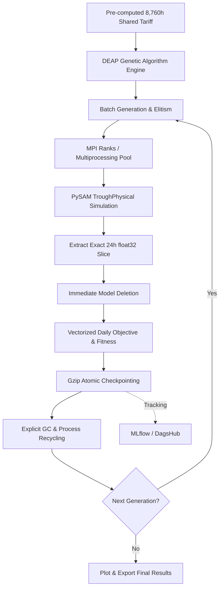

# NYS Concentrated Solar Power Design & Operational Optimisation

A high-performance, memory-optimized parallel simulation–optimisation pipeline for Concentrated Solar Power (CSP) parabolic-trough plants. Powered by **NREL PySAM**, **DEAP Genetic Algorithms**, **MPI**, Python multiprocessing, and **MLflow / DagsHub** tracking.

Repository: [Ary0Darkk/NYS-Design-Optimisation-using-PySAM](https://github.com/Ary0Darkk/NYS-Design-Optimisation-using-PySAM)

---

## Architecture Overview

The system is built on `optimized_pipeline`, an ultra memory-efficient architecture engineered specifically to eliminate out-of-memory errors and C-level memory leaks common in long PySAM simulation runs:



### Key Memory & Performance Innovations
1. **24-Hour Simulation Slices**: PySAM normally generates full 8,760-element output arrays (~490 KB per simulation). `optimized_pipeline` immediately extracts only the exact 24-hour slice required for that representative day as compact `float32` arrays (~672 bytes per evaluation), achieving a **99.8% memory reduction**.
2. **Aggressive Worker Process Recycling**: By default, worker processes recycle every 25 evaluations (`maxtasksperchild=25`). This completely purges unmanaged C++ memory allocated inside PySAM shared libraries before leaks can accumulate.
3. **Pre-Computed Shared Tariff**: The 8,760-hour Haryana electricity tariff is computed and cached once at startup as a contiguous `float32` array in shared memory, eliminating redundant disk I/O, pandas operations, and inter-process copying.
4. **Gzip-Compressed Checkpointing**: Atomic checkpoints (`checkpoint_latest.pkl.gz` and `checkpoint_best.pkl.gz`) use gzip compression to minimize disk footprint while ensuring instant crash recovery with full random state restoration.
5. **Periodic Garbage Collection**: Explicit `gc.collect()` runs at the conclusion of every generational evaluation wave.
6. **Unified Dual Parallelism**: Seamlessly auto-detects MPI if executed under `mpirun`/`mpiexec`, and gracefully falls back to local multiprocessing on desktop or workstation environments.

---

## Repository Structure

| Component / File | Responsibility |
| :--- | :--- |
| `optimized_pipeline/` | **Primary Production Package** |
| `optimized_pipeline/config.py` | Typed configuration models (`PipelineConfig`), bounds, and defaults |
| `optimized_pipeline/simulation.py` | PySAM `TroughPhysical` runner, physical constraints, and 24h slice extraction |
| `optimized_pipeline/tariff.py` | Pre-computed `float32` tariff array with disk caching and demand processor |
| `optimized_pipeline/objective.py` | Vectorized 24h revenue, parasitic power, and thermal loss objective calculation |
| `optimized_pipeline/chromosome.py` | Compact integer chromosome representation and DEAP type initialization |
| `optimized_pipeline/operators.py` | In-place bounded Gaussian integer mutation and crossover operators |
| `optimized_pipeline/checkpoint.py` | Gzip-compressed atomic checkpoints with deterministic configuration hashing |
| `optimized_pipeline/parallel.py` | MPI communicator abstraction (`Communicator`, `StandaloneComm`) and batching |
| `optimized_pipeline/tracker.py` | Multi-rank synchronized logging, MLflow/DagsHub integration, and plot exports |
| `optimized_pipeline/engine.py` | Evolutionary search loop, process recycling, and Hall of Fame elitism |
| `optimized_pipeline/cli.py` | Command-line interface with memory-tuning flags (`--max-tasks-per-child`, etc.) |
| `main.py` | Canonical entry point forwarding directly to `optimized_pipeline.cli:main` |
| `deap_ga_optimiser.py` | Backward-compatible optimizer interface forwarding to `optimized_pipeline` |
| `config.py` | Root configuration exposing `CONFIG` dict backed by `optimized_pipeline.config` |
| `tests/` | Complete unit test suite (100% passing across configuration, PySAM, GA, pricing) |
| `job_*.pbs`, `job*.pbs` | PBS batch submission scripts for HPC clusters (C-DAC Pratyush/Param/etc.) |

---

## Optimization Model

- **5 Season-Wide Design Variables**:
  - `specified_total_aperture`: Total solar field aperture area [m²] (8,000 to 12,000)
  - `Row_Distance`: Spacing pitch between parallel collector rows [m] (10 to 25, strictly `> W_aperture`)
  - `ColperSCA`: Modules per Solar Collector Assembly (2 to 10)
  - `W_aperture`: Aperture collector width [m] (4 to 8)
  - `L_SCA`: Collector assembly length [m] (50 to 200)
- **3 Daily Operational Variables** (optimized per representative day, 7 days per season = 21 genes):
  - `m_dot`: HTF mass flow limit [kg/s] (2 to 12)
  - `T_startup`: Field startup threshold temperature [°C] (300 to 380)
  - `T_shutdown`: Field shutdown temperature [°C] (250 to 300, strictly `<= T_startup`)
- **Chromosome Length**: 5 design + 21 operational = **26 integer genes**.

---

## Setup & Installation

Requirements: Python 3.12+, `uv` package manager, and C/C++ compiler for PySAM dependencies.

```bash
# Clone the repository
git clone https://github.com/Ary0Darkk/NYS-Design-Optimisation-using-PySAM.git
cd NYS-Design-Optimisation-using-PySAM

# Install dependencies and sync virtual environment
uv sync

# Activate environment
# On Linux/macOS:
source .venv/bin/activate
# On Windows PowerShell:
.\.venv\Scripts\Activate.ps1
```

---

## Running the Tests

Execute the automated test suite with pytest:

```bash
uv run pytest
```

---

## Running the Optimizer

### 1. Local Single-Machine Run
Run any of the 4 seasons (`winter`, `summer`, `monsoon`, `post`):

```bash
# Quick local run with custom population and generations:
uv run python main.py --season winter --pop-size 28 --generations 10

# Or using the PowerShell / Bash runners:
.\run.ps1 --season summer
./run.bat --season monsoon

# Disable remote MLflow tracking for offline testing:
uv run python main.py --season winter --no-tracking
```

### 2. Available CLI Flags
```text
options:
  -h, --help            Show help message and exit
  --season {winter,summer,monsoon,post}
                        Season to optimize (default: summer)
  --generations GENERATIONS
                        Number of GA generations override (default: 100)
  --pop-size POP_SIZE   Population size override (default: 112)
  --workers WORKERS     Worker processes per rank (default: 4 or LOCAL_WORKERS)
  --max-tasks-per-child MAX_TASKS_PER_CHILD
                        Recycle worker process after N simulations (default: 25)
  --seed SEED           Random seed for reproducibility (default: 41)
  --no-tracking         Disable remote DagsHub/MLflow experiment tracking
```

### 3. HPC Cluster Execution (PBS)
For multi-node cluster runs using PBS:

```bash
# Submit winter season job
qsub job_winter.pbs

# Submit all 4 seasons simultaneously
bash submit_all_seasons.sh
```

---

## Experiment Tracking & Results

- **Local Results**: Saved to `results/GA_results/<season>_best_solution_<timestamp>.json` and `<season>_logbook.csv`.
- **Fitness Plots**: Saved to `plots/GA/<season>_convergence_<timestamp>.png`.
- **Checkpoints**: Stored as `.pkl.gz` in `checkpoints/GA/` (only latest and best are retained, saving gigabytes of disk space).
- **Remote MLflow / DagsHub**: Authenticate using `~/.dagshub_token` to automatically log metrics, artifacts, and convergence plots.
