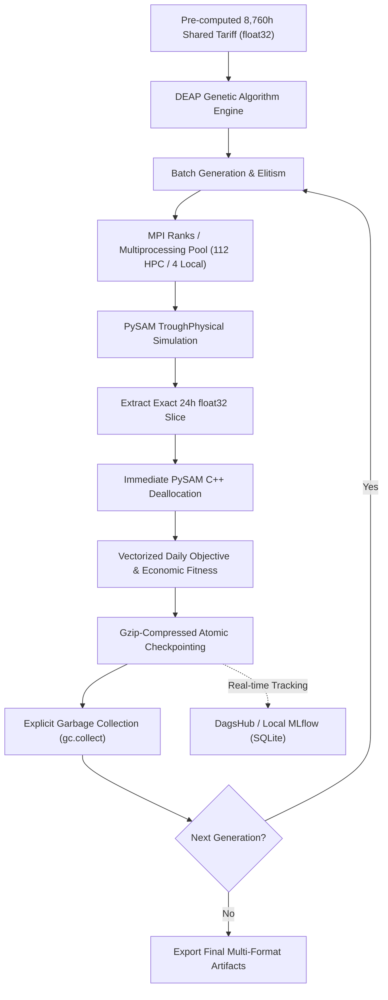

# Concentrated Solar Power (CSP) Plant Design & Operational Optimization

[](https://github.com/Ary0Darkk/Solar-Plant-Design-Optimisation/actions/workflows/ci.yml)
[](https://www.python.org/downloads/)
[](https://nrel-pysam.readthedocs.io/)
[](https://deap.readthedocs.io/)
[](https://github.com/astral-sh/ruff)
[](LICENSE)

A high-throughput, memory-optimized parallel simulation–optimization engine for Concentrated Solar Power (CSP) parabolic-trough plants. Built on **NREL PySAM**, **DEAP Genetic Algorithms**, **MPI (Message Passing Interface)**, Python multiprocessing, and **MLflow / DagsHub** experiment tracking.

**Repository**: [Ary0Darkk/Solar-Plant-Design-Optimisation](https://github.com/Ary0Darkk/Solar-Plant-Design-Optimisation)

---

## Table of Contents

- [Architecture Overview](#architecture-overview)
- [Key Memory & Performance Innovations](#key-memory--performance-innovations)
- [Optimization Model & Chromosome Structure](#optimization-model--chromosome-structure)
- [Physical & Geometric Constraints](#physical--geometric-constraints)
- [Representative Days & Calendar Indexing](#representative-days--calendar-indexing)
- [Worker Scaling & Automatic Local Fallback](#worker-scaling--automatic-local-fallback)
- [Repository Structure](#repository-structure)
- [Setup & Installation](#setup--installation)
- [Running the Optimizer](#running-the-optimizer)
  - [Command-Line Interface (CLI)](#command-line-interface-cli)
  - [Local Execution](#local-execution)
  - [HPC Batch Execution (PBS)](#hpc-batch-execution-pbs)
- [Experiment Tracking & Output Artifacts](#experiment-tracking--output-artifacts)
- [Automated Testing & CI](#automated-testing--ci)

---

## Architecture Overview

The system is powered by the `optimized_pipeline` architecture, engineered specifically to eliminate out-of-memory (OOM) failures and C-level memory leaks that occur during long PySAM simulations:



---

## Key Memory & Performance Innovations

1. **24-Hour Simulation Slices**: PySAM standard runs generate full 8,760-element arrays (~490 KB per simulation). `optimized_pipeline` extracts strictly the 24-hour window needed for the representative day into contiguous `float32` arrays (~672 bytes per evaluation), delivering a **99.8% memory reduction**.
2. **Aggressive Process Recycling (`maxtasksperchild=25`)**: Multiprocessing workers recycle after every 25 simulations, purging unmanaged C++ heap allocations inside PySAM shared libraries before leaks accumulate.
3. **Pre-Computed Shared Tariff**: The 8,760-hour Haryana dynamic electricity tariff is loaded and normalized once at startup into contiguous memory, eliminating redundant disk I/O and inter-process copying.
4. **Lightweight Tracking Footprint (`mlflow-skinny`)**: Uses `mlflow-skinny` and SQLite/local tracking, purging ~270 MB of unused ML serving libraries (`scipy`, `pyarrow`, `scikit-learn`, `flask`, `docker`) while preserving 100% of metric and artifact tracking.
5. **Gzip-Compressed Checkpointing**: Atomic checkpoints (`checkpoint_latest.pkl.gz`, `checkpoint_best.pkl.gz`, and `checkpoint_gen_{gen}.pkl.gz`) shrink disk usage to ~5–10 KB per generation with 100% deterministic PRNG restoration.
6. **Smart Standby Logic**: On overcast days with zero electrical generation, solar field circulation losses are clamped to prevent unrealistic penalties.

---

## Optimization Model & Chromosome Structure

Each candidate design is encoded as a **26-gene integer chromosome**:

```text
Chromosome Layout (Length = 26):
[D1, D2, D3, D4, D5 | Op1_d1, Op2_d1, Op3_d1 | ... | Op1_d7, Op2_d7, Op3_d7]
 └── 5 Design Genes ──┘ └─── 21 Daily Operational Genes (3 genes × 7 days) ───┘
```

### 1. Season-Wide Plant Design Parameters (5 Genes)

| Variable | Description | Bound [Low, High] | Physical Unit |
| :--- | :--- | :---: | :---: |
| `specified_total_aperture` | Total solar field aperture area | `[8000, 12000]` | $\text{m}^2$ |
| `Row_Distance` | Spacing pitch between parallel collector rows | `[10, 25]` | $\text{m}$ |
| `ColperSCA` | Number of collector modules per SCA | `[2, 10]` | modules |
| `W_aperture` | Aperture collector width | `[4, 8]` | $\text{m}$ |
| `L_SCA` | Collector assembly length | `[50, 200]` | $\text{m}$ |

### 2. Daily Operational Schedule Parameters (3 Genes $\times$ 7 Days = 21 Genes)

| Variable | Description | Bound [Low, High] | Physical Unit |
| :--- | :--- | :---: | :---: |
| `m_dot` | Heat Transfer Fluid (HTF) mass flow limit | `[2, 12]` | $\text{kg/s}$ |
| `T_startup` | Solar field startup threshold temperature | `[300, 380]` | $^\circ\text{C}$ |
| `T_shutdown` | Solar field shutdown threshold temperature | `[250, 300]` | $^\circ\text{C}$ |

---

## Physical & Geometric Constraints

Candidates that violate physical feasibility are caught **before simulation** and penalized with a fitness of $-10^{13}$:

1. **Vehicular Maintenance Corridor**:
   $$\text{Row\_Distance} - W_{\text{aperture}} \ge 3.5\text{ m}$$
   Ensures adequate clearance for mirror washing trucks and heavy maintenance vehicles between rows.
2. **Thermal Deadband**:
   $$T_{\text{startup}} - T_{\text{shutdown}} \ge 15^\circ\text{C}$$
   Prevents rapid thermal cycling and pump oscillation around operating setpoints.

---

## Representative Days & Calendar Indexing

The optimizer models each season using **7 representative days** (28 days total per year) mapped to non-leap year (8,760-hour) weather datasets:

| Season | Local Day | Date (`MM-DD`) | Day Index (`day_index`) | PySAM Time Window (seconds) |
| :--- | :---: | :---: | :---: | :---: |
| **Winter** | Day 1 to 7 | `01-08`, `01-13`, `01-16`, `01-28`, `02-21`, `02-22`, `12-12` | `7`, `12`, `15`, `27`, `51`, `52`, `345` | 604,800 – 29,894,400 |
| **Summer** | Day 1 to 7 | `03-09`, `03-16`, `04-12`, `04-17`, `05-07`, `05-16`, `05-21` | `67`, `74`, `101`, `106`, `126`, `135`, `140` | 5,788,800 – 12,182,400 |
| **Monsoon** | Day 1 to 7 | `06-13`, `07-06`, `07-15`, `07-22`, `07-23`, `08-04`, `08-11` | `163`, `186`, `195`, `202`, `203`, `215`, `222` | 14,083,200 – 19,267,200 |
| **Post-Monsoon** | Day 1 to 7 | `09-05`, `09-20`, `10-03`, `10-12`, `11-03`, `11-17`, `11-23` | `247`, `262`, `275`, `284`, `306`, `320`, `326` | 21,340,800 – 28,252,800 |

- **`local_index`** (`0`–`6`): Slices operational genes in the chromosome (`offset = 5 + local_index * 3`).
- **`day_index`** (`0`–`364`): Controls PySAM simulation window (`day_index * 86400`) and hourly tariff slicing (`day_index * 24`).

---

## Worker Scaling & Automatic Local Fallback

The pipeline dynamically configures worker concurrency based on execution context:

- **HPC Cluster**: When executed under a cluster scheduler (`PBS_JOBID` or `SLURM_JOB_ID`), worker concurrency targets **112 workers per node** (or `$LOCAL_WORKERS`).
- **Local Workstation**: When executed on a local laptop/desktop without an HPC scheduler, the pipeline **automatically falls back to 4 workers** (or CPU count), preventing memory thrashing or system freezing.
- **Manual Override**: Passing `--workers N` on the command line always overrides automatic detection.

---

## Repository Structure

```text
Solar-Plant-Design-Optimisation/
├── .github/workflows/ci.yml       # GitHub Actions CI workflow (ruff + pytest)
├── checkpoints/GA_optimized/      # Gzip-compressed checkpoints (.pkl.gz)
├── electricity_data/              # Hourly demand profiles and tariff datasets
├── logs/                          # Multi-rank execution logs
├── optimized_pipeline/            # Core Production Package
│   ├── checkpoint.py              # Atomic gzip-compressed state persistence
│   ├── chromosome.py              # 26-gene chromosome encoder & DEAP types
│   ├── cli.py                     # CLI parser with scheduler detection
│   ├── config.py                  # Dataclass configuration models & bounds
│   ├── engine.py                  # Genetic algorithm engine & elitism loop
│   ├── objective.py               # Vectorized daily economic revenue & losses
│   ├── operators.py               # Custom bounded mutation & crossover
│   ├── parallel.py                # MPI Communicator & standalone fallback
│   ├── run.py                     # Convenience runner script
│   ├── simulation.py              # PySAM runner & 24h slice extraction
│   ├── tariff.py                  # Pre-computed float32 tariff caching
│   ├── tracker.py                 # Multi-format artifact exports & MLflow
│   └── weather.py                 # Representative calendar day mapping
├── plots/GA_plots/                # High-resolution convergence plots (PNG/PDF)
├── results/GA_results/            # CSV, JSON, and Multi-sheet Excel summaries
├── simulation/                    # Weather dataset & Gurgaon plant config
├── tests/                         # Comprehensive Pytest test suite (55 tests)
├── config.yaml                    # Global YAML pipeline configuration
├── config.py                      # Backward-compatible configuration bridge
├── deap_ga_optimiser.py           # Backward-compatible API wrapper
├── job_*.pbs                      # HPC batch scripts (Winter, Summer, Monsoon, Post)
├── main.py                        # Primary entry point
└── pyproject.toml                 # Dependencies, scripts, and tool configs
```

---

## Setup & Installation

### Prerequisites
- Python **3.12+**
- [`uv`](https://docs.astral.sh/uv/) (recommended for fast virtual environment management)

```bash
# Clone the repository
git clone https://github.com/Ary0Darkk/Solar-Plant-Design-Optimisation.git
cd Solar-Plant-Design-Optimisation

# Create virtual environment and install dependencies
uv sync

# Activate virtual environment
# Windows PowerShell:
.venv\Scripts\Activate.ps1
# Linux / macOS:
source .venv/bin/activate
```

---

## Running the Optimizer

### Command-Line Interface (CLI)

```bash
uv run python main.py --help
```

```text
options:
  -h, --help            Show this help message and exit
  --season {winter,summer,monsoon,post}
                        Season to optimize (default: summer)
  --generations GENERATIONS
                        Number of GA generations override (default: 100)
  --pop-size POP_SIZE   Population size override (default: 112)
  --workers WORKERS     Worker processes per rank (default: 112 on HPC, fallback to 4 on local machine)
  --max-tasks-per-child MAX_TASKS_PER_CHILD
                        Recycle worker process after N simulations (default: 25)
  --seed SEED           Random seed for reproducibility (default: 41)
  --min-price MIN_PRICE Minimum electricity tariff in INR/kWh (default: 3.0)
  --max-price MAX_PRICE Maximum electricity tariff in INR/kWh (default: 8.0)
  --job-id JOB_ID       Scheduler Job ID for tracking (auto-detected from PBS_JOBID / SLURM_JOB_ID)
  --config CONFIG       Path to YAML configuration file (default: config.yaml in project root)
  --no-tracking         Disable remote experiment tracking (uses local SQLite fallback)
```

### Local Execution

```bash
# Fast test run on winter season (automatically uses 4 workers locally)
uv run python main.py --season winter --pop-size 14 --generations 5

# Full summer season optimization
uv run python main.py --season summer

# Offline run with local tracking only
uv run python main.py --season post --no-tracking
```

### HPC Batch Execution (PBS)

On HPC clusters (e.g., C-DAC Pratyush, Param), submit seasonal PBS jobs:

```bash
# Submit single seasonal job
qsub job_winter.pbs
qsub job_summer.pbs
qsub job_monsoon.pbs
qsub job_post.pbs

# Pre-flight MPI connectivity test across compute nodes
qsub job_mpi_test.pbs
```

---

## Experiment Tracking & Output Artifacts

Every completed run exports five artifacts to `results/GA_results/` and `plots/GA_plots/`:

1. **Dual Convergence Plots**:
   - High-resolution **300 DPI PNG** (`<season>_convergence_<timestamp>.png`).
   - Publication-ready **vector PDF** (`<season>_convergence_<timestamp>.pdf`).
2. **Multi-Sheet Excel Workbook** (`<season>_summary_<timestamp>.xlsx`):
   - *Sheet 1: Optimal Solution*: Best fitness, job ID, and 5 plant design variables.
   - *Sheet 2: Operational Schedule*: 7 representative days with dates, mass flow limits, and startup/shutdown temperatures.
   - *Sheet 3: Generation History*: Complete GA logbook history (`gen`, `nevals`, `avg`, `std`, `min`, `max`).
3. **Executive Markdown Report** (`<season>_executive_report_<timestamp>.md`):
   - Formatted markdown summary with tabular design parameters and operational schedules.
4. **Machine-Readable Outputs**:
   - Single-row flat CSV (`<season>_<timestamp>.csv`).
   - Structured JSON solution (`best_solution_<season>.json`).
   - GA evolutionary logbook CSV (`<season>_logbook.csv`).
5. **MLflow / DagsHub Tracking**:
   - Automatically records scheduler metadata (`job_id`, `queue`, `hostname`, `total_cpus`, `git_commit`), generational metrics, and operational schedules.
   - Graceful fallback to local SQLite database (`results/mlflow.db`) when remote credentials are not present.

---

## Automated Testing & CI

The project maintains **42 automated unit tests** covering configuration, PySAM simulations, genetic operators, CLI parsing, and checkpointing:

```bash
# Run complete test suite
uv run pytest -v

# Run code formatting and linting
uv run ruff check .
uv run ruff format --check .
```

### GitHub Actions CI
Every commit pushed to `main` triggers automated Linux testing via [.github/workflows/ci.yml](.github/workflows/ci.yml):
- Python 3.12 environment setup via `astral-sh/setup-uv`.
- Ruff syntax and PEP 8 style validation.
- Complete 42-test pytest suite execution.

---

## License

This project is licensed under the MIT License — see the [LICENSE](LICENSE) file for details.
